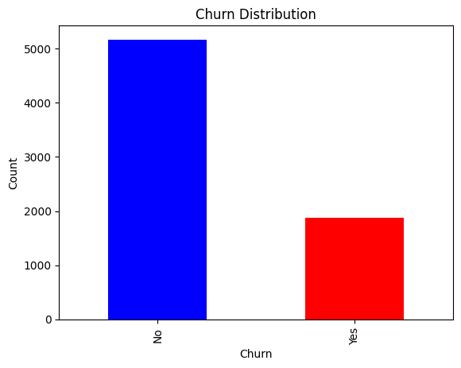
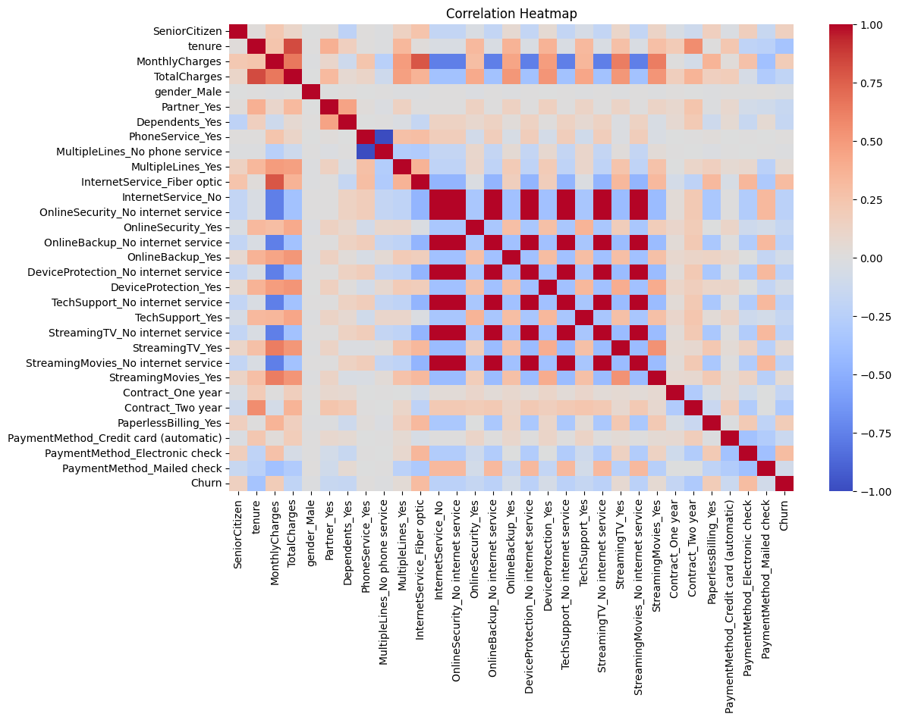
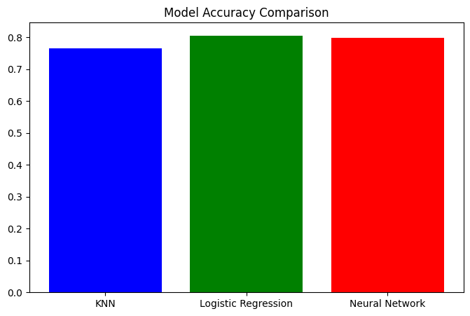
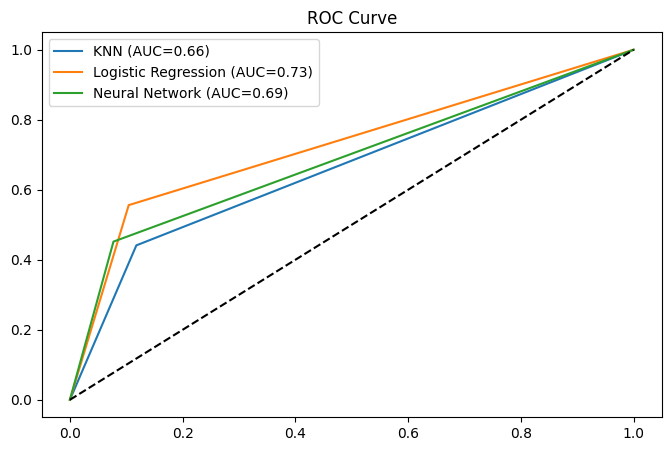
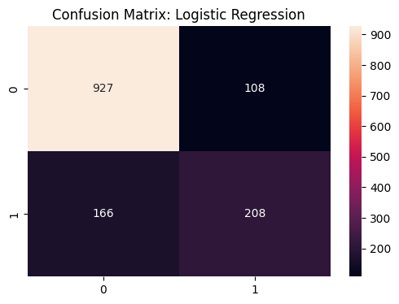
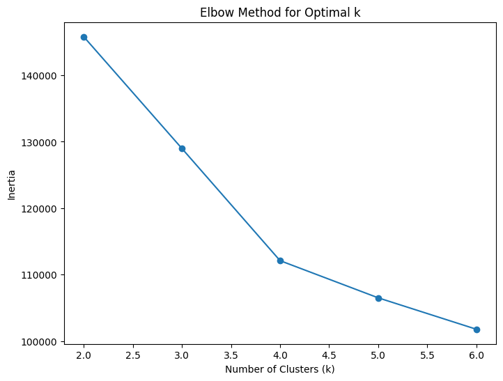
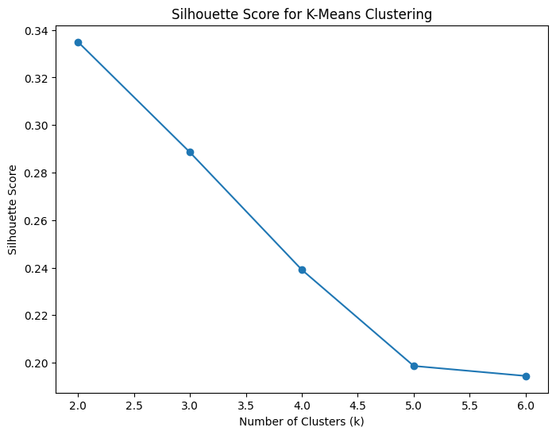
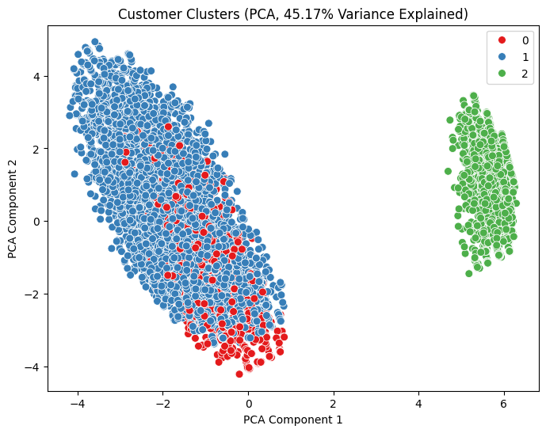

# Telco Customer Churn Prediction

Predicting which customers of a telecom company will cancel their service (churn), and grouping customers into segments, using Python and scikit-learn.

This was a group project for **CSE422: Artificial Intelligence** at BRAC University (2025). The full analysis, with code and outputs, is in [`telco_customer_churn.ipynb`](telco_customer_churn.ipynb).

## The data

The [Telco Customer Churn dataset](https://www.kaggle.com/datasets/blastchar/telco-customer-churn) has **7,043 customers** and **19 features**:

- **Numerical (4):** senior citizen, tenure, monthly charges, total charges
- **Categorical (15):** gender, partner, dependents, phone and internet services, add-ons such as online security and tech support, contract type, paperless billing and payment method
- **Target:** `Churn` (Yes / No)

## Workflow

1. **Exploration:** summary statistics, variance and skewness; histograms of numerical features; bar charts of every categorical feature and of each feature against churn; box plots of numerical features by churn; and a correlation heatmap.
2. **Cleaning:** `TotalCharges` had 11 blank values. They were converted to numbers and filled with the median.
3. **Encoding and scaling:** one-hot encoding of categorical features and standard scaling of tenure and charges.
4. **Splitting:** a stratified 70 / 10 / 20 train, validation and test split, giving 4,929 training and 1,409 test customers.
5. **Supervised models:** K-Nearest Neighbours (k = 5), Logistic Regression, and a neural network (an MLP with hidden layers of 100, 50 and 25 units).
6. **Unsupervised model:** K-Means clustering, with k chosen using the elbow method and silhouette scores, and clusters visualised with PCA.

## Results

Test-set results for predicting churn:

| Model | Accuracy | Precision | Recall | F1-score | AUC |
|---|---|---|---|---|---|
| K-Nearest Neighbours | 0.77 | 0.57 | 0.44 | 0.50 | 0.66 |
| **Logistic Regression** | **0.81** | 0.66 | **0.56** | **0.60** | **0.73** |
| Neural network (MLP) | 0.80 | **0.68** | 0.45 | 0.54 | 0.69 |

**Logistic Regression performed best overall**, with the highest accuracy, recall, F1-score and AUC. The neural network was slightly more precise but caught fewer of the customers who actually left.

  
  

## Customer segments

K-Means with **k = 3** split customers into three groups. The first two PCA components explain about 45% of the variance.

| Cluster | Share of customers | Average monthly charge | Profile |
|---|---|---|---|
| 0 | 10% | $42 | No fibre internet; average tenure about 32 months |
| 1 | 69% | $82 | Highest spenders; 64% on fibre-optic internet; most likely to use paperless billing |
| 2 | 22% | $21 | Lowest spenders; most often on two-year contracts; fewest senior citizens |

  
  

## Possible improvements

- Train the models on the scaled features. The scaling step is applied before the data is re-encoded for splitting, so the models currently see unscaled values, which also explains Logistic Regression's convergence warning.
- Calculate AUC and ROC curves from predicted probabilities rather than class labels, to give a fuller picture of each model.
- Use the validation set to tune hyperparameters such as k in KNN and the network size.
- Handle class imbalance (far fewer customers churn than stay) with class weights or resampling to raise recall.

## Running the notebook

The notebook was written in Google Colab and loads the CSV from Google Drive. To run it elsewhere:

1. Download `WA_Fn-UseC_-Telco-Customer-Churn.csv` from the Kaggle link above.
2. Change `file_path` in the first code cell to point to it, and remove the two `google.colab` lines.
3. Install the requirements: `pip install pandas numpy scikit-learn matplotlib seaborn`.

## Author

Repository maintained by **Fahrim Arabin Farsa** · [Portfolio](https://farsa27.github.io) · [GitHub](https://github.com/Farsa27) · [LinkedIn](https://www.linkedin.com/in/fahrim-farsa-a80b21266/)
